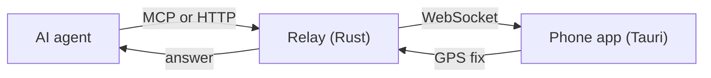

# Whereabouts

Let your AI agent ask **your phone** where you are, on demand. You host the relay. Sign-in and user data live in Supabase.



The relay keeps no location history. It sends a ping, the phone reads its GPS now, and the answer goes back to the agent.

## Status

Early MVP. The phone answers pings **while the app is open**. Waking a closed app needs push notifications. See [the roadmap](docs/roadmap.md).

## Repo layout

| Path | What |
|------|------|
| [`server/`](server) | Rust relay (axum). Agents call it over HTTP or MCP; the phone holds a WebSocket to it. |
| [`app/`](app) | Tauri v2 phone app (Android / iOS). Signs in, then answers pings with a GPS fix. |
| [`supabase/`](supabase) | Database migrations and tests. |
| [`infra/`](infra) | OpenTofu for the dev and prod environments. |
| [`scripts/`](scripts) | Local dev, end-to-end check, deploy, hook install. |
| [`docs/`](docs) | Architecture, protocol, prior art, roadmap, contributing. |

## Quick start (local)

1. Start Supabase and the relay locally. The relay runs in the foreground, so keep this terminal open:

   ```bash
   scripts/dev-up.sh
   ```

   It writes `server/.env.local` (gitignored) and prints the `app/.env.local` lines.

2. In a second terminal, run the phone app in the Android emulator. Copy the template, then fill in the values that `dev-up.sh` prints:

   ```bash
   cp app/.env.example app/.env.local
   cd app && npm install && npm run tauri android dev
   ```

   Sign in with the dev email and password form.

3. Check the whole path, from agent to phone and back. Run it in the second terminal while the stack and relay run. It needs `curl`, `jq`, `openssl`, `node` and `npm`. It prints PASS or FAIL per check and exits 1 on failure. For another port, set the same value for both: `WB_PORT=8788 scripts/e2e-local.sh`:

   ```bash
   scripts/e2e-local.sh
   ```

## Connect your agent

Coming next: sign-in through the browser (OAuth). See [roadmap](docs/roadmap.md). Once live, you add the relay to your MCP client and sign in once. You never create or paste a token.

```bash
claude mcp add --transport http whereabouts <prod-relay-url>/mcp
```

Relay URLs: [live URLs](infra/README.md#live-urls). The tool and its arguments: [protocol](docs/protocol.md).

## Docs

- [Architecture](docs/architecture.md): components, sign-in and ping flow, security, limits
- [Protocol](docs/protocol.md): HTTP, MCP and WebSocket at intent level
- [Prior art](docs/prior-art.md): what exists and why this project
- [Roadmap](docs/roadmap.md)
- [Contributing](docs/contributing.md): hooks, line limit, adding a migration
- [Infrastructure](infra/README.md): live URLs, deploy steps, migrations

## License

[MIT](LICENSE)
