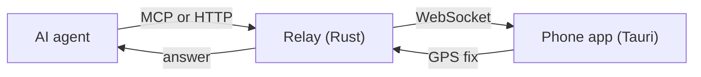

# Whereabot

Let your AI agent ask **your phone** where you are, on demand. You host the relay. Sign-in and user data live in Supabase.



The relay keeps no location history. It sends a ping, the phone reads its GPS now, and the answer goes back to the agent. What is stored, for how long, and who sees your location: [privacy](docs/privacy.md).

## Status

Early MVP, in beta. iOS answers in the background through push. Android answers only while the app is open. See [the roadmap](docs/roadmap.md).

## Repo layout

| Path | What |
|------|------|
| [`server/`](server) | Rust relay (axum). Agents call it over HTTP or MCP; the phone holds a WebSocket to it. |
| [`app/`](app) | Tauri v2 phone app (Android / iOS). Signs in, then answers pings with a GPS fix. |
| [`supabase/`](supabase) | Database migrations and tests. |
| [`infra/`](infra) | OpenTofu for the dev and prod environments. |
| [`scripts/`](scripts) | Local dev, end-to-end check, deploy, hook install. |
| [`docs/`](docs) | Source of the docs site. |
| [`site/`](site) | Landing page and OAuth consent page. |
| [`docs-site/`](docs-site) | VitePress build of the docs site. |
| [`design-system/`](design-system), [`brand/`](brand) | Shared CSS tokens and components; logo files and usage rules. |

## Connect your agent

1. Install the app: see [Get started on whereabot.io](https://whereabot.io/#start), or [install from the browser](docs/install-from-browser.md).
2. Sign in with Google on the phone.
3. Add the relay to your agent:

   ```bash
   claude mcp add --transport http whereabot https://relay.whereabot.io/mcp
   ```

4. In Claude Code run `/mcp` and sign in with the **same Google account** as on the phone. You never paste a token.
5. On Android, keep the app open while the agent asks, until Android push ships.

Relay URLs: [live URLs](infra/README.md#live-urls). The tool and its arguments: [protocol](docs/protocol.md).

## Self-host

Run your own relay and Supabase project with the OpenTofu code in [`infra/`](infra). Steps: [infra/README.md](infra/README.md). Build the app with your Supabase and relay values ([`app/.env.example`](app/.env.example)), and add your relay to your agent. To run everything on one computer first: [local quick start](docs/contributing.md#quick-start-local).

## Docs

All docs, with the generated MCP and wire references: [whereabot.io/docs](https://whereabot.io/docs/). In this repo:

- [Architecture](docs/architecture.md): components, sign-in and ping flow, security, limits
- [Protocol](docs/protocol.md): HTTP, MCP and WebSocket at intent level
- [Request flow](docs/request-flow.md): every state, notification and agent result of one request
- [Location sharing](docs/location-sharing.md): let another person's agent ask for your location
- [Privacy](docs/privacy.md): what is stored, retention, who sees your location
- [Operations](docs/operations.md) and [infrastructure](infra/README.md): how it runs, deploys and releases
- [Prior art](docs/prior-art.md) and [roadmap](docs/roadmap.md)
- [Listings](docs/listings.md): MCP directories, `server.json`, how to publish

## Community

- [Contributing](docs/contributing.md): local setup, hooks, rules, adding a migration
- [Security policy](SECURITY.md): report vulnerabilities privately
- [Code of conduct](CODE_OF_CONDUCT.md)

## License

[MIT](LICENSE). Third-party material: [THIRD_PARTY_NOTICES.md](THIRD_PARTY_NOTICES.md).
