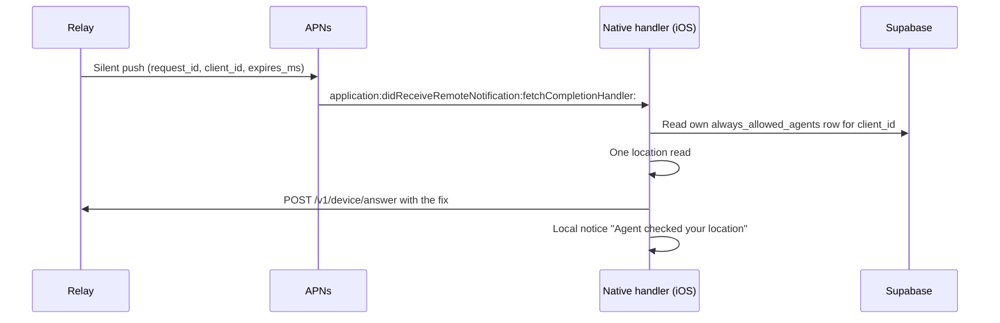

# Always allow

An always-allowed agent never "wants to know". The phone shares on its own and then tells the user: "`<Agent>` checked your location".

## Where the choice lives

The list is the Supabase table `always_allowed_agents` ([migration](../supabase/migrations/20261028060000_always_allowed_agents.sql)): `user_id`, `client_id`, `client_name`, `created_at`. RLS limits each user to own rows.

- **Writes need the user's own session.** Insert, update and delete require a JWT without a `client_id` claim. An agent's OAuth token carries `client_id`, so an agent can read its user's list but never add itself. pgTAP: [`supabase/tests/always_allowed_agents_rls_test.sql`](../supabase/tests/always_allowed_agents_rls_test.sql).
- **The app writes it** when the user taps Always allow (in the app or on a notification) and deletes the row on Remove. localStorage keeps a cache. On sign-in and on each return to the foreground the app uploads pending notification taps, copies its old phone-only list once, then replaces the cache with the server rows ([`app/src/always-allowed-sync.ts`](../app/src/always-allowed-sync.ts)).
- **Generic ids** (`unknown`, `agent-key`) are never always-allowed; the table rejects them.

## What the relay sends

The relay reads the table with the agent's user JWT, like `push_tokens` ([`server/src/push/always_allowed_wake.rs`](../server/src/push/always_allowed_wake.rs)). A failed read counts as "not always allowed".

| Step | Push | When |
|------|------|------|
| 1 | Silent: `aps.content-available: 1`, `apns-push-type: background`, priority `5`, keys `request_id`, `client_id`, `expires_ms`; no alert, sound or badge. | When the consent alert would go out (no phone answers within about 2 s, or none is connected). |
| 2 | Alert: body `<Agent> is checking your location`, `category` `LOCATION_AUTO` (one action, Share). | No answer about 8 s after step 1. Never sent when the request was answered. |

Other agents keep the consent alert: `Your agent <Agent> wants to know your location`, category `LOCATION_REQUEST` (Reject, Allow, Always allow). Every alert also carries `agent_name`, so a lock-screen Always allow can store the name.

## What the phone does

- **Second check.** The native handler answers only if the user's own row exists; the relay's word alone never shares a location.
- **Foreground.** The web view answers over its socket ("Shared automatically" in History) and shows the same notice. The native handler skips silent pushes while the app is active.
- **Notice.** Title `<Agent> checked your location`, body `Shared just now. Manage in Whereabot.`, no actions. A tap opens History. It also removes a "checking" alert for the same request that arrived meanwhile.
- **Fallback.** iOS does not wake a force-quit app, and throttles silent pushes (Low Power Mode, budget). Then step 2 shows; Share answers in the background like Allow. A tap on the alert opens the app, which answers on its own.
- **Native code:** [`SilentPushHook.swift`](../app/src-tauri/background-answer-plugin/ios/Sources/SilentPushHook.swift) adds the delegate method to tao's app delegate; the app declares `UIBackgroundModes` `remote-notification` ([`Info.ios.plist`](../app/src-tauri/Info.ios.plist)).
