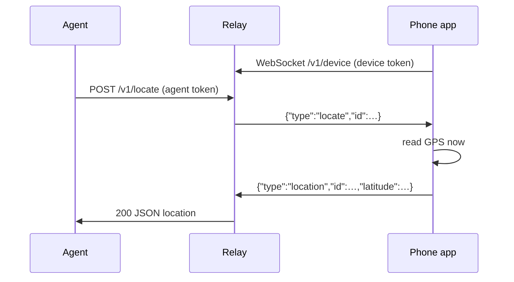

# Architecture

## Components

- **Agent** — any AI agent or script that can send an HTTP request.
- **Relay** ([`server/`](../server)) — a small Rust service you host. It holds no location history.
- **Phone app** ([`app/`](../app)) — a Tauri v2 app on Android or iOS. It keeps a WebSocket open to the relay and answers pings with a fresh GPS fix.

## Why a relay

A phone has no public address, and an agent cannot reach it directly. The phone opens an outbound connection to the relay and keeps it open, so the relay can push a ping to the phone at any time. HTTP alone cannot do this, because with HTTP only the phone can start a request.

## Ping flow

If no phone is connected, the relay answers `503`. If the phone does not answer in time, it answers `504`. Message shapes are in [protocol.md](protocol.md).

## Security

- Two separate secrets: the **agent token** may ask for a location; the **device token** may answer. Leaking one does not grant the other. Both are compared in constant time.
- Run the relay behind TLS (`wss://` / `https://`), for example with Caddy or a tunnel. Tokens are bearer secrets.
- The relay keeps a location only in memory, for the length of one request.
- The user sees each answered ping in the app. Silent tracking is not a goal.

## Limits today

- One phone per relay.
- The phone answers only while the app runs. See [roadmap.md](roadmap.md) for push-based wake-up.
