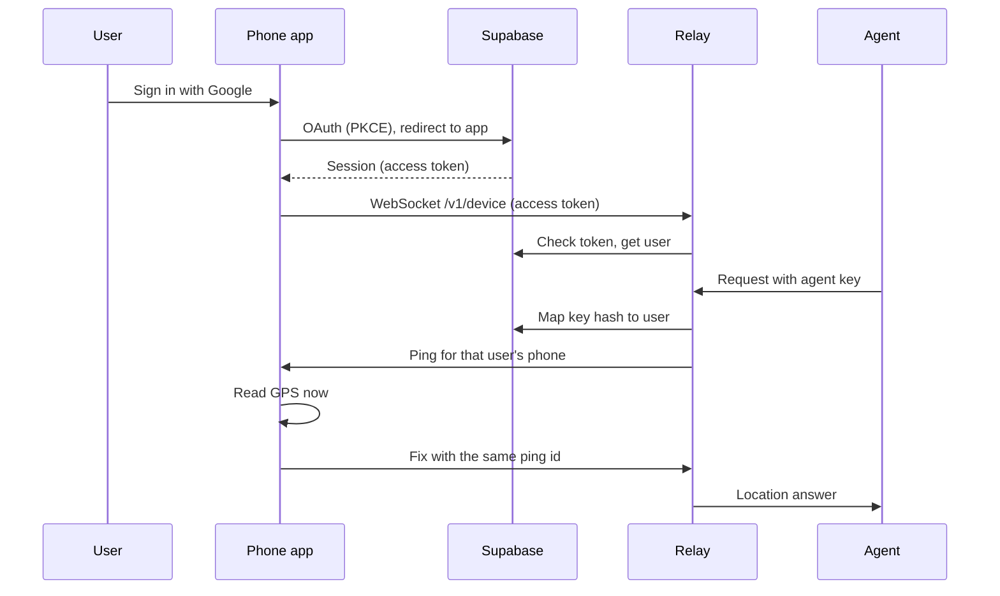

# Architecture

## Components

- **Agent**: any AI agent or script. It calls the relay over MCP or HTTP with an agent key.
- **Relay** ([`server/`](../server)): a small Rust service in a container. It checks keys, pings the phone, and passes the fix back. It holds no location history.
- **Supabase**: user sign-in (Google, and email for dev) and the table of agent keys. See [`supabase/`](../supabase).
- **Phone app** ([`app/`](../app)): a Tauri v2 app on Android or iOS. It signs in, keeps a WebSocket open to the relay, and answers pings with a fresh GPS fix.

Deploy steps per environment: [infra/README.md](../infra/README.md).

## Why a relay

A phone has no public address, and an agent cannot reach it directly. The phone opens an outbound connection to the relay and keeps it open. The relay can then send a ping at any time. HTTP alone cannot do this, because only the phone can start a request.

## Sign-in and ping

The relay keeps one phone connection per user. If the user has no connected phone, the agent gets an offline answer. Status codes and message shapes: [protocol.md](protocol.md).

## Security

- **Two credentials.** The agent key may ask for a location. The phone access token may answer one. Neither works for the other side.
- **Isolation per user.** An agent key maps to one user. It reaches only that user's phone. The isolation tests in [`server/tests/`](../server/tests) cover this.
- **No location storage.** A fix lives in memory for one request. Nothing writes it to a database or a log.
- **Keys hashed.** The database stores the SHA-256 hash of each agent key. The plaintext is shown once, at creation.
- **Row-level security.** Supabase RLS limits each user to their own agent keys. Writes go through functions. See [`supabase/migrations/`](../supabase/migrations).
- **TLS.** Clients reach the relay over HTTPS and WSS. The container host terminates TLS.
- **Bearer tokens.** Treat every key and token as a secret. Revoke an agent key in the app when it leaks.

## Limits today

- **One relay instance.** Phone connections live in memory, so the relay runs as exactly one instance.
- **The app must be open.** The phone answers only while the app runs. See [roadmap.md](roadmap.md) for push wake-up.
- **One phone per user.** A new phone connection replaces the old one.
- **Timeouts.** A ping waits at most 120 seconds for the phone.
