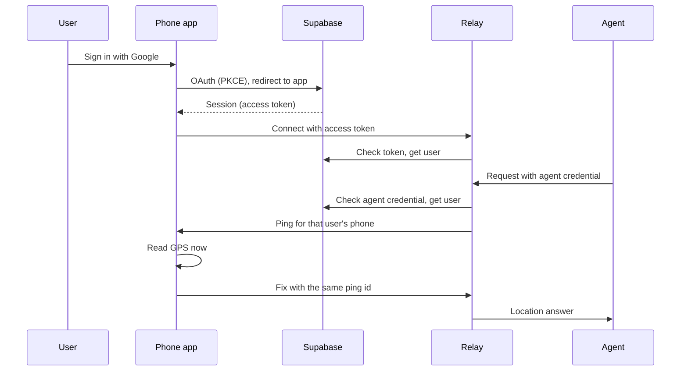

# Architecture

## Components

- **Agent**: any AI agent or script. It calls the relay over MCP or HTTP.
- **Relay** ([`server/`](../server)): a small Rust service in a container. It checks credentials, pings the phone, and passes the fix back. It holds no location history.
- **Supabase**: user sign-in (Google, and email for dev) and the agent key table. See [`supabase/`](../supabase).
- **Phone app** ([`app/`](../app)): a Tauri v2 app on Android or iOS. It signs in, keeps a WebSocket open to the relay, and answers pings with a fresh GPS fix.

Live URLs and deploy steps per environment: [infra/README.md](../infra/README.md).

## Why a relay

A phone has no public address, and an agent cannot reach it directly. The phone opens an outbound connection to the relay and keeps it open. The relay can then send a ping at any time. HTTP alone cannot do this, because only the phone can start a request.

## Sign-in and ping

The relay keeps one phone connection per user. If the user has no connected phone, the agent gets an offline answer. Status codes and message shapes: [protocol.md](protocol.md).

## Consent on the phone

Each ping carries the agent's OAuth client id and an `expires_ms` deadline. The phone shows a consent prompt for that agent. The user can allow once, deny, or choose always-allow for that agent, which skips the prompt next time. The phone then answers with one of:

- a location;
- `denied`: the user declined, or did not respond before `expires_ms`;
- `unavailable`: location permission is off, or no fix.

The relay turns each answer into a distinct agent-facing error. If the phone is offline, the error names the signed-in account, so the user can spot a mismatch with the phone. Wire format: [protocol.md](protocol.md).

## Security

- **Two credentials.** The agent credential may ask for a location. The phone access token may answer one. Neither works for the other side.
- **Isolation per user.** An agent credential maps to one user. It reaches only that user's phone. The isolation tests in [`server/tests/`](../server/tests) cover this.
- **No location storage.** A fix lives in memory for one request. Nothing writes it to a database or a log.
- **Hashed agent keys.** The database stores a hash of each agent key, never the plaintext. The plaintext is shown once. Algorithm and schema: [`supabase/migrations/`](../supabase/migrations).
- **Row-level security.** Supabase RLS limits each user to their own agent keys. Writes go through functions.
- **TLS.** Clients reach the relay over HTTPS and WSS. The container host terminates TLS.
- **No user-managed tokens.** Users never create or paste tokens. Agents sign in with OAuth. Agent keys remain a headless fallback; see [protocol](protocol.md#agent-keys-headless-fallback).

## Limits today

- **One relay instance.** Phone connections live in memory, so the relay runs as exactly one instance.
- **The app must be open.** The phone answers only while the app runs. Push wake-up: [roadmap.md](roadmap.md).
- **One phone per user.** A new phone connection replaces the old one. See [protocol](protocol.md#phone-to-relay).
- **Timeouts.** Ping waits are bounded. See [protocol](protocol.md#http-post-v1locate).
