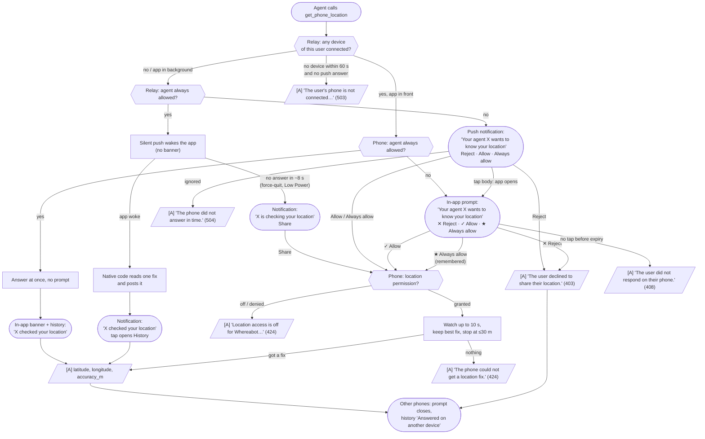

# Location request flow

Every state a request passes through, every notification the user can see, and every result the agent gets. Wire formats: [protocol](protocol.md). Components: [architecture](architecture.md).

Legend: rounded boxes are what the user sees; hexagons are relay decisions; `[A]` = answer the agent gets.

## Notifications at a glance

| When | Title / body | Buttons | Status |
|---|---|---|---|
| Agent not always allowed, app not in front | "Your agent X wants to know your location" | Reject · Allow · Always allow | Live |
| Always-allowed agent, answered in the background | "X checked your location" — "Shared just now. Manage in Whereabot." | none (tap opens History) | Live |
| Always-allowed agent, iOS did not wake the app | "X is checking your location" | Share | Live |
| App open in front | No system notification; in-app prompt or banner | Reject · Allow · Always allow | Live |
| Shared request, not always allowed | "R's agent X wants to know your location" | Reject · Allow · Always allow | New |
| Shared request, always allowed, iOS did not wake the app | "R's agent X is checking your location" | Share | New |

Every outcome is also written to the in-app **Request history**.

## Shared requests

The agent passes `person` to ask for someone who shares their location with its user. The relay first checks the share; it then runs the same flow above on the **owner's** phones. "Your agent X" reads "R's agent X", where R is the requester. "Always allowed" means the owner always allows agent X **for R**. Extra agent results:

- No active share matches `person` (unknown or revoked): "Nobody named P shares their location with you…" (404).
- More than one owner matches: the text lists each "Name (email)" (409).
- The owner rejects: "NAME declined to share their location." (403).

Details: [location sharing](location-sharing.md).
